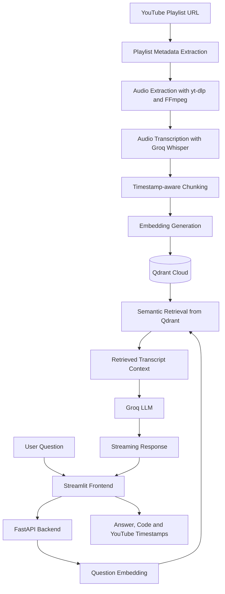

NeetCode Interview Copilot
An AI-powered coding interview revision assistant that turns a YouTube
programming playlist into a searchable knowledge base. Ask questions
about concepts covered in the playlist, receive explanations in English
or Hinglish, generate implementations in Python, C++ or Java, and jump
back to the relevant video moments using timestamped YouTube references.
Built by Akshat Garg
Portfolio project exploring Retrieval-Augmented Generation (RAG),
semantic search, LLM-based answer generation, streaming APIs and
interactive AI applications.

Table of Contents
- Overview
- Key Features
- Architecture
- End-to-End Workflow
- Technology Stack
- Project Structure
- Getting Started
- Environment Variables
- Run the Application
- API Endpoints
- Tests
- Dataset and Processing Notes
- Deployment
- Limitations and Future
  Improvements
Overview
Watching a long programming playlist is useful, but finding a particular
explanation again can be slow. NeetCode Interview Copilot addresses this
by processing playlist videos into timestamp-aware text chunks,
embedding those chunks, and storing the vectors in Qdrant.

When a user asks a question, the application:
1. Converts the question into an embedding.
2. Retrieves semantically relevant transcript chunks from Qdrant.
3. Sends the retrieved context to a Groq-hosted language model.
4. Streams the generated response through FastAPI to the Streamlit
   interface.
5. Displays relevant YouTube video timestamps so the user can revisit
   the source.
The application is designed to ground explanations in the supplied
playlist context. If the retrieved material does not contain enough
information, the assistant should communicate that limitation rather
than present unsupported claims as if they came from the videos.
Key Features
- Playlist-based knowledge base: Ingests video metadata and
  processes playlist audio.
- Timestamp-aware transcription: Converts speech into timestamped
  transcript segments.
- Semantic search: Retrieves relevant content using sentence
  embeddings and Qdrant vector search.
- RAG-based responses: Uses retrieved transcript context to guide
  answer generation.
- English and Hinglish: Choose the explanation language.
- Code generation: Request implementations in Python, C++ or Java.
- Streaming responses: Displays generated answers as they arrive.
- YouTube references: Provides source video links with timestamps.
- Interactive interface: Streamlit chat UI with example prompts,
  preferences and conversation history.
Architecture

End-to-End Workflow
The project has two major workflows: offline ingestion and indexing,
and online question answering.
A. Offline ingestion and indexing
This workflow builds the searchable knowledge base. It is run when
preparing or updating a playlist, not for every user question.
1. Playlist metadata extraction
Module: app/ingestion/playlist_extractor.py
- Accepts a YouTube playlist URL.
- Extracts the playlist ID and video metadata using yt-dlp.
- Records useful fields such as video ID, title, URL and playlist
  position.
- Saves metadata as JSON under data/metadata/.
2. Audio extraction
Module: app/ingestion/audio_extractor.py
- Reads the saved playlist metadata.
- Downloads the available audio for each video using yt-dlp.
- Uses FFmpeg to convert audio to mono, 16 kHz WAV.
- Validates the resulting audio and records processing status in a
  manifest.
- Skips already processed valid files unless forced to reprocess.
3. Speech transcription
Module: app/ingestion/transcriber.py
- Converts audio into FLAC where required.
- Splits long audio into manageable windows with a small overlap.
- Sends audio parts to Groq Whisper (whisper-large-v3-turbo).
- Converts part-relative segment timestamps back to the original video
  timeline.
- Removes duplicated overlap content and saves timestamped transcript
  JSON.
4. Timestamp-aware chunking
Module: app/processing/chunker.py
- Reads transcript segments.
- Groups nearby segments into chunks targeting approximately 75
  seconds.
- Uses a 10-second overlap to preserve context across chunk
  boundaries.
- Prefers sentence boundaries when they are close to the target.
- Stores each chunk with its text, start/end time, video metadata and
  YouTube URL.
The overlap helps retrieval retain context when an explanation spans a
chunk boundary. Each chunk keeps its source timing so the application
can link back to the relevant video moment.
5. Embedding generation
Modules: app/processing/embeddings.py,
app/processing/embed_pipeline.py
- Uses sentence-transformers/all-MiniLM-L6-v2.
- Converts each chunk's text into a 384-dimensional vector.
- Normalizes embeddings.
- Processes chunks in batches and saves embedding records with their
  original metadata.
6. Vector storage
Module: app/vectorstore/qdrant_store.py
- Connects to Qdrant Cloud.
- Creates or validates a collection configured for 384-dimensional
  cosine similarity vectors.
- Generates deterministic point IDs.
- Uploads vectors and their metadata in batches.
- Uses upsert operations so the same point IDs can be uploaded again
  safely.
B. Online question answering
This workflow runs when a user asks a question in the application.
1. User submits a question
The Streamlit interface collects:
- The question.
- Explanation language: English or Hinglish.
- Programming language: no code, Python, C++ or Java.
- Number of transcript chunks to retrieve (top_k).
2. Question embedding and retrieval
Module: app/retrieval/retriever.py
- Embeds the question with the same MiniLM model used for transcript
  chunks.
- Searches the Qdrant collection using cosine similarity.
- Returns the top matching chunks and their metadata.
- Supports optional playlist or video filters.
3. Context construction and answer generation
Module: app/generation/groq_llm.py
- Formats retrieved chunks as source context.
- Sends the question, language preference and context to the
  configured Groq chat model.
- Instructs the model to ground playlist-specific explanations in
  retrieved context.
- Requests structured explanations and, when selected, code with
  complexity analysis.
- Formats source references with the original video timestamps.
4. Streaming through the API
Modules: app/api/routes.py, main.py
- FastAPI exposes health, search, normal answer and streaming
  endpoints.
- The streaming endpoint sends generated content as Server-Sent Events
  (SSE).
- The frontend consumes the stream and updates the answer as tokens
  arrive.
5. User sees the result
The Streamlit interface renders:
- Markdown explanations.
- Syntax-highlighted code blocks with Streamlit's copy-code
  affordance.
- YouTube source links and timestamps.
- The conversation history for the current session.
Technology Stack
  Area                                    Technology
  Language                                Python
Dependency and environment management   uv
Playlist metadata and audio download    yt-dlp
Audio conversion                        FFmpeg
Speech-to-text                          Groq Whisper whisper-large-v3-turbo
Text chunk embeddings                   Sentence Transformers all-MiniLM-L6-v2
Vector database                         Qdrant Cloud
LLM answer generation                   Groq API
Backend                                 FastAPI
API server                              Uvicorn
Frontend                                Streamlit
Validation and tests                    pytest

The project uses direct SDKs and APIs rather than relying on LangChain
or LlamaIndex.
Project Structure
youtube-rag/
├── app/
│   ├── ingestion/
│   │   ├── playlist_extractor.py
│   │   ├── audio_extractor.py
│   │   └── transcriber.py
│   ├── processing/
│   │   ├── chunker.py
│   │   ├── embeddings.py
│   │   └── embed_pipeline.py
│   ├── vectorstore/
│   │   └── qdrant_store.py
│   ├── retrieval/
│   │   └── retriever.py
│   ├── generation/
│   │   └── groq_llm.py
│   └── api/
│       └── routes.py
├── frontend/
│   └── streamlit_app.py
├── data/
│   ├── metadata/
│   ├── audio/
│   ├── transcripts/
│   ├── chunks/
│   └── embeddings/
├── tests/
├── main.py
├── pyproject.toml
├── uv.lock
├── requirements.txt
├── .env.example
├── .gitignore
└── README.md
Generated audio, transcript, chunk and embedding data are local
processing artifacts and should not be committed to GitHub. The deployed
question-answering service uses the indexed vectors in Qdrant.
Getting Started
Prerequisites
Install or create accounts for:
- Python 3.12
- uv
- FFmpeg (ffmpeg and ffprobe)
- Groq API access
- A Qdrant Cloud cluster
- Git
1. Clone the repository
git clone https://github.com/<YOUR_GITHUB_USERNAME>/neetcode-interview-copilot.git
cd neetcode-interview-copilot
Replace the repository URL with your actual GitHub repository URL.
2. Create the environment and install dependencies
uv sync
If you prefer pip and the repository's exported requirements file:
python -m venv .venv
source .venv/bin/activate
pip install -r requirements.txt
3. Configure environment variables
Create a local .env file in the project root. Use .env.example as a
template if it is present.
GROQ_API_KEY=your_groq_api_key
GROQ_MODEL=llama-3.3-70b-versatile

QDRANT_URL=your_qdrant_cluster_url
QDRANT_API_KEY=your_qdrant_api_key
QDRANT_COLLECTION_NAME=youtube_playlist_chunks
Never commit .env or expose API keys in source code, screenshots, logs
or public repositories.
4. Start the backend
uv run uvicorn main:app --reload
- API base URL: http://127.0.0.1:8000
- Interactive API docs: http://127.0.0.1:8000/docs
- Health check: http://127.0.0.1:8000/health
5. Start the frontend
In a second terminal, from the project root:
uv run streamlit run frontend/streamlit_app.py
Open the local Streamlit URL printed in the terminal, normally
http://localhost:8501.
Environment Variables
  Variable                   Purpose
  GROQ_API_KEY             Authenticates requests to Groq
GROQ_MODEL               Selects the chat model used for answer generation
QDRANT_URL               Qdrant Cloud cluster endpoint
QDRANT_API_KEY           Authenticates with Qdrant
QDRANT_COLLECTION_NAME   Name of the vector collection
API_URL                  Frontend's FastAPI base URL; defaults to local backend

For deployment, configure secrets in the hosting provider's
environment/secrets settings rather than committing them to Git.
API Endpoints
The FastAPI application exposes the following endpoints:

  Method   Endpoint        Purpose
  GET    /health       Check backend health
POST   /search       Retrieve relevant transcript chunks
POST   /ask          Generate a complete answer
POST   /ask/stream   Stream an answer using Server-Sent Events

Open /docs on the running backend for the live request schemas and
interactive testing.

Example request for the streaming endpoint:
{
  "question": "Explain largest rectangle in histogram",
  "language": "hinglish",
  "code_language": "cpp",
  "top_k": 5
}
Set code_language to null if code is not required. Supported code
languages are Python, C++ and Java.
Tests
Run the test suite with:
uv run pytest -v
Or, if using the activated virtual environment:
pytest -v
Tests cover core playlist extraction, audio processing, transcription,
chunking, embedding generation and embedding-pipeline behavior. External
services are mocked in unit tests where appropriate; a passing unit test
suite does not replace an end-to-end test against configured Groq and
Qdrant services.
Dataset and Processing Notes
The initial playlist metadata contained 317 video entries. The
completed transcript, chunk and embedding pipeline covered 313
videos at the time this README was written. Four videos did not have
completed transcript files:
- Q2Tw6gcVEwc
- cjWnW0hdF1Y
- uQrRoqLfX1A
- vRbbcKXCxOw
The Qdrant collection was populated with 3,933 vector points at the
last recorded verification. These are project progress figures, not a
guarantee that every playlist entry is currently available or processed.
Deployment
A suggested deployment layout is:
- FastAPI backend: Render Web Service.
- Streamlit frontend: Streamlit Community Cloud.
- Vector database: Qdrant Cloud.
- LLM and transcription API: Groq.
Backend on Render
Typical service configuration:
- Build command: pip install -r requirements.txt
- Start command: uvicorn main:app --host 0.0.0.0 --port $PORT
Add GROQ_API_KEY, GROQ_MODEL, QDRANT_URL, QDRANT_API_KEY and
QDRANT_COLLECTION_NAME in the Render environment settings.
Frontend on Streamlit Community Cloud
- Connect the GitHub repository.
- Set the app entry point to frontend/streamlit_app.py.
- Configure API_URL in Streamlit secrets to the deployed FastAPI
  base URL.
Example Streamlit secrets entry:
API_URL = "https://your-backend-service.onrender.com"
The frontend reads API_URL from the environment or Streamlit secrets.
Confirm this behavior in the deployed version before publishing the app
URL.

Free hosting tiers may sleep, have limited memory or impose request
limits. The embedding model may require more memory than a small free
backend instance provides. Test the complete application after
deployment and select hosting resources accordingly.

Deployment status: Add the live frontend and backend URLs here once
deployment and end-to-end testing are complete.
- Frontend: TODO
- Backend API: TODO
- API documentation: TODO
Limitations and Future Improvements
Potential next steps:
- Add ingestion status and retry controls to the interface.
- Improve observability with structured logs and request IDs.
- Add authentication and rate limiting before opening the API to
  unrestricted public use.
- Add caching for repeated questions and frequently used embeddings.
- Add automated integration tests for the complete retrieval and
  streaming flow.
- Improve handling of unavailable videos and incomplete transcripts.
- Evaluate retrieval quality with a curated question-and-answer test
  set.
- Add deployment health checks, resource monitoring and usage limits.
Responsible Use
This project is intended as a learning and revision aid. Verify
important technical details against the linked source videos and
official documentation. Only process and distribute video/audio content
when you have the necessary rights or permission, and follow YouTube's
terms and the applicable service-provider policies.
Author
Akshat Garg

Built as an AI engineering portfolio project to explore practical RAG
systems, semantic retrieval, LLM applications, API development and
deployment.